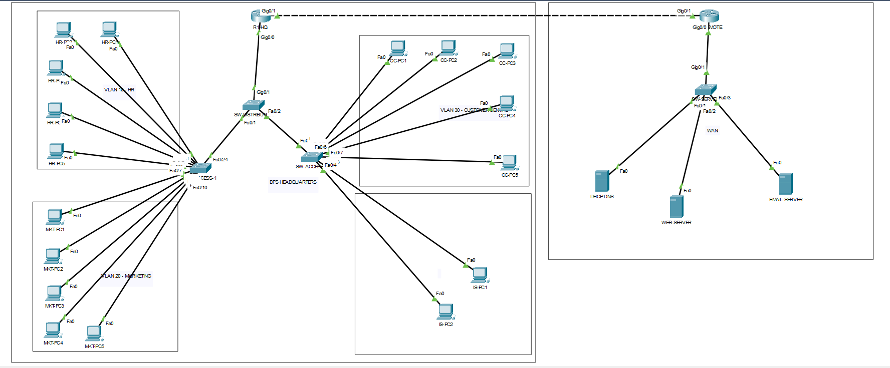

# Secure Enterprise Network Design

I designed and validated a segmented two-site enterprise network for a simulated financial services company in Cisco Packet Tracer, as a project for my MSc in Cybersecurity Technology at Northumbria University London.

It has four departmental VLANs addressed with VLSM, router-on-a-stick inter-VLAN routing, single-area OSPF with MD5 authentication over a point-to-point WAN, a site-to-site IPsec tunnel scoped to HR traffic, extended ACLs at both sites, and a set of layered Layer 2 controls at the access edge. I tested all of it against a structured matrix.

This is coursework rather than a production build, and I've written up what I'd change in [docs/residual-risk.md](docs/residual-risk.md). The thing I'd raise first isn't a misconfiguration at all — it's that the VPN protects exactly what the brief asked it to protect, which turns out not to be the thing most worth protecting.

---

## What it needed to do

Four departmental segments at headquarters. A separate site hosting DNS, web and email, reachable over a WAN. Protected communication between Human Resources and that server site.

Two things weren't clear in the brief, so I made a call on both. I treated "IT" and "Information Systems" as the same department, which gave Information Systems two users and the other three five each. And I implemented "appropriate WAN technology" as a point-to-point Gigabit Ethernet link between the two ISR routers.

---

## Topology



I used a two-tier hierarchy — access switches to endpoints, a distribution switch aggregating up to R1-HQ. I did consider a separate core layer and decided against it: for seventeen hosts it adds a layer without fixing the thing that actually constrains the design. The cost of that decision is that R1-HQ becomes a single point of failure, which I've written about properly in the residual risk doc rather than glossing over.

| Device | What it does |
|---|---|
| R1-HQ | Inter-VLAN routing, DHCP relay, ACL 100, IPsec endpoint |
| R2-REMOTE | Server-site routing, ACL 110, IPsec endpoint |
| SW-DISTRIBUTION | Trunk aggregation toward R1-HQ |
| SW-ACCESS-1 | Human Resources and Marketing |
| SW-ACCESS-2 | Customer Centric and Information Systems |
| SW-SERVER | Server site |

---

## Addressing

I allocated from one private /24 using VLSM, sizing each subnet to what the department actually needed rather than giving everyone the same mask. That uses 72 addresses — about 28% of the block — and leaves 184 for growth.

| VLAN | Department | Users | Subnet | Gateway | Usable | Spare |
|---|---|---|---|---|---|---|
| 30 | Customer Centric | 5 | 192.168.10.0/27 | 192.168.10.1 | .2 – .30 | 24 |
| 10 | Human Resources | 5 | 192.168.10.32/28 | 192.168.10.33 | .34 – .46 | 8 |
| 20 | Marketing | 5 | 192.168.10.48/28 | 192.168.10.49 | .50 – .62 | 8 |
| 40 | Information Systems | 2 | 192.168.10.64/29 | 192.168.10.65 | .66 – .70 | 3 |

| Location | Block | Purpose |
|---|---|---|
| Headquarters LAN | 192.168.10.0/24 | Four departmental VLANs |
| WAN point-to-point | 10.10.10.0/30 | HQ to server site |
| External server site | 192.168.20.0/28 | DNS, web, email |

The servers are statically addressed — DHCP-DNS on .2, web on .3, email on .4, gateway .1.

**Why I didn't just use /28s everywhere.** Uniform masks would have been easier to document and much harder to get wrong. But the departments don't grow at the same rate, and a flat allocation ignores that. I kept the blocks contiguous per site so expanding later doesn't mean renumbering anything. What it costs is that one mistake in a non-uniform mask is expensive to find.

---

## Segmentation

Four VLANs, 802.1Q trunking, and router-on-a-stick inter-VLAN routing on subinterfaces off R1-HQ Gi0/0.

The part I found most interesting is that the trunk configuration is itself a security control. Each trunk only carries the VLANs that specific link needs:

| Trunk | Link | Native VLAN | Allowed VLANs |
|---|---|---|---|
| SW-ACCESS-1 Fa0/24 | to SW-DISTRIBUTION Fa0/1 | 999 | 10, 20, 999 |
| SW-ACCESS-2 Fa0/24 | to SW-DISTRIBUTION Fa0/2 | 999 | 30, 40, 999 |
| SW-DISTRIBUTION Gi0/1 | to R1-HQ Gi0/0 | 999 | 10, 20, 30, 40, 999 |

So a Customer Centric frame can't reach SW-ACCESS-1. Not because something filters it, but because there's no path for it to take. That distinction matters — a filter can be misconfigured, a missing path can't.

I made VLAN 999 the native VLAN on every trunk and put every unused port in it, shut down. It has no routed interface. That closes off double tagging, where you send a frame with two VLAN tags and the outer one gets stripped at the first trunk, dropping the frame into a VLAN it shouldn't reach.

More detail in [docs/design.md](docs/design.md).

---

## Services

DNS, web and email all live at the external site. DHCP runs from there too, which meant relaying requests across the WAN with `ip helper-address` on each subinterface — a client's first DHCP message is a broadcast, and routers don't forward those.

I derived the DHCP scopes from the VLSM plan rather than picking numbers: each pool starts at first-usable-plus-one and runs to the host count minus the gateway. So the scope config is a direct function of the addressing, and if the addressing is right the scopes are right.

The trade-off is that everything is centralised. Every client at headquarters now depends on the WAN link to get an address and resolve a name.

---

## Routing

Single-area OSPF between the two routers, with MD5 authentication on the WAN interface and every departmental subinterface set passive, so no adjacency can be formed from a user VLAN.

I didn't introduce any hierarchy, because summarisation across two routers buys nothing. What I did do was preserve summarisation boundaries in the addressing, so that if this ever grew, adding hierarchy wouldn't mean renumbering the whole thing first.

---

## Security controls

| Layer | What I implemented |
|---|---|
| Layer 2 | Port security on 17 access ports with risk-tiered violation modes, per-trunk VLAN pruning, blackhole native VLAN, unused ports shut down |
| Layer 3–4 | Extended ACL 100 outbound on R1-HQ Gi0/0.10, extended ACL 110 on R2-REMOTE Gi0/0 |
| Cross-layer | Site-to-site IPsec with ESP, scoped to HR traffic by crypto ACL |
| Device | SSH v2 only with a lawful-access banner, enable secret, privilege-separated accounts, password encryption, VLAN 1 shut down |

I layered the access edge deliberately. For a frame from an unauthorised device on SW-ACCESS-1 to reach Customer Centric data, it has to get past four separate controls — and those four fail in completely different ways. Port security falls to MAC spoofing. Pruning falls to someone carelessly adding a VLAN six months from now. The native VLAN trick falls to nothing I can think of, which is why I like it.

That's the actual argument for defence in depth, and it's not the one I expected going in. It isn't that four controls are stronger than one. It's that four controls which fail independently are harder to get past than one strong control everything depends on.

Every one of them is topological, though. Not one validates who the person at the keyboard is.

More detail in [docs/security-controls.md](docs/security-controls.md).

---

## Testing

I tested connectivity, routing, segmentation, access control and the VPN against a structured matrix. Method and results are in [docs/validation.md](docs/validation.md).

The negative tests taught me more than the positive ones. Confirming Marketing can't reach HR, that an unlisted web request to the DNS host gets dropped by ACL 110, and that Marketing traffic to the server site leaves the IPsec counters completely unchanged — those prove the policy is doing something, which a successful ping never does.

---

## What I'd change before production

Full write-up in [docs/residual-risk.md](docs/residual-risk.md). The things I'd raise, in the order I'd raise them:

**The VPN protects the wrong thing.** It protects HR traffic to the server site, which is what the brief asked for. Customer data crosses the same WAN link with nothing on it. The tunnel is correctly configured and still insufficient, and I only saw that when I stopped asking whether the control worked and started asking what actually travels on that link.

**IKEv1 with legacy parameters.** It establishes and it protects what it's scoped to protect, but the Phase 1 parameters are behind current guidance. I'd move to IKEv2.

**Router-on-a-stick is an accepted bottleneck rather than a solved one.** All inter-departmental traffic crosses one physical link, twice. At seventeen hosts that isn't a measured problem, and I'd rather have a known limit than an unknown one — but it needs a documented trigger, which is when inter-VLAN volume approaches that link's capacity.

**The ACLs are stateless.** `established` checks TCP flags, not session state. Production needs stateful inspection at the boundary.

**The OSPF MD5 key is static and never rotated.**

---

## What's in here

```
docs/       Design, security controls, testing, residual risk
configs/    Device running-configurations
diagrams/   Topology
```

---

## What I got out of it

Two things, mostly.

The first is the independent-failure-modes point above. I went in thinking defence in depth meant stacking controls, and came out thinking it means stacking controls that break differently.

The second is about where real weaknesses hide. The most interesting problem in this design isn't anything I configured incorrectly. The IPsec tunnel works. It does exactly what it was asked to do. The problem is the scope of what it was asked to do — and you can't find that by checking configurations, only by asking what data actually moves and what would happen if someone read it.

---

Mark Nwaodor · [linkedin.com/in/marknwaodor](https://linkedin.com/in/marknwaodor)
