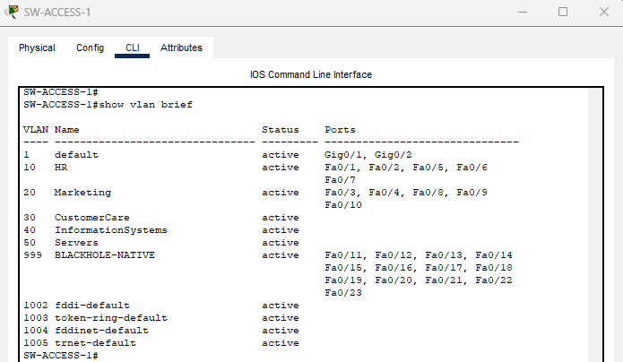
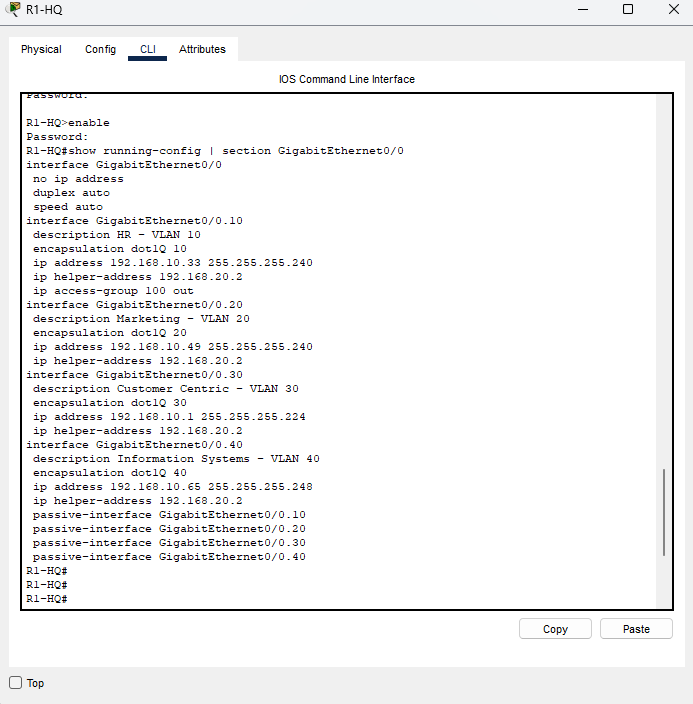
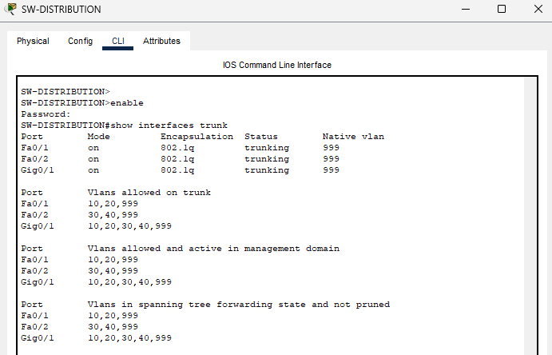
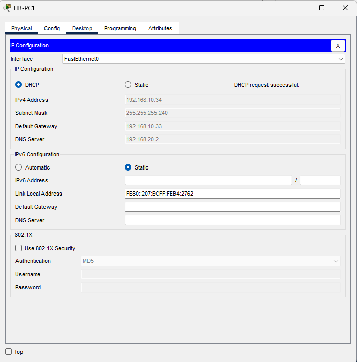
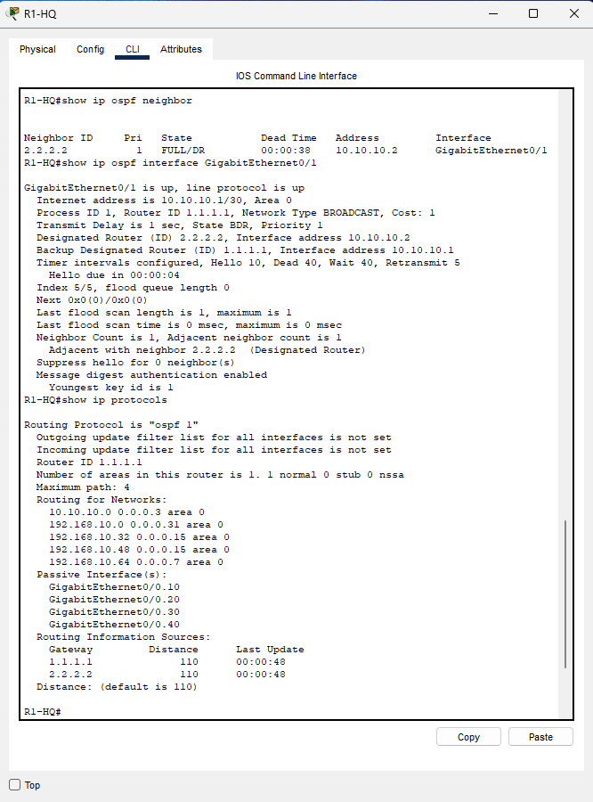
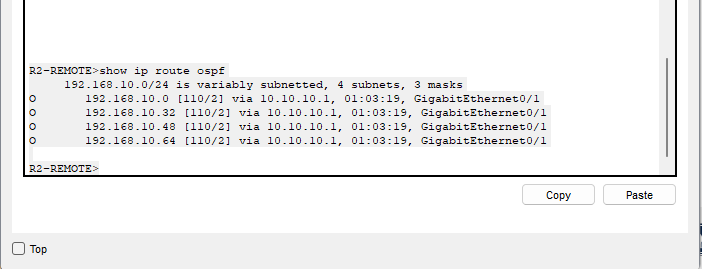

# Design Detail

## VLANs and access ports

| VLAN | Name | Department | Switch | Access ports | Gateway |
|---|---|---|---|---|---|
| 10 | HR | Human Resources | SW-ACCESS-1 | Fa0/1–2, Fa0/5–7 | Gi0/0.10 — 192.168.10.33 |
| 20 | Marketing | Marketing | SW-ACCESS-1 | Fa0/3–4, Fa0/8–10 | Gi0/0.20 — 192.168.10.49 |
| 30 | CustomerCare | Customer Centric | SW-ACCESS-2 | Fa0/1–2, Fa0/5–7 | Gi0/0.30 — 192.168.10.1 |
| 40 | InformationSystems | Information Systems | SW-ACCESS-2 | Fa0/3–4 | Gi0/0.40 — 192.168.10.65 |
| 50 | Servers | Reserved, no ports assigned | All three switches | None | Not routed |
| 999 | BLACKHOLE-NATIVE | Unused ports, native VLAN | SW-ACCESS-1, SW-ACCESS-2 | Fa0/11–23 and Fa0/8–23, shut down | Not routed |

*HR on Fa0/1–2 and Fa0/5–7, Marketing on Fa0/3–4 and Fa0/8–10, and everything from Fa0/11 up sitting in VLAN 999 and shut down.*

I reserved VLAN 50 for servers and never assigned a port to it. The servers live at the remote site, so there's nothing for it to carry — but leaving the VLAN defined means adding a local server segment later doesn't require renumbering anything.

---

## Inter-VLAN routing

Router-on-a-stick. Four 802.1Q subinterfaces on R1-HQ Gi0/0, each one carrying a departmental gateway with its own subnet mask, and `ip helper-address 192.168.20.2` so DHCP requests get relayed to the remote site.

*Four dot1Q subinterfaces with descriptions, the four gateway addresses at .33/28, .49/28, .1/27 and .65/29, the helper address on all four, ACL 100 applied outbound on Gi0/0.10, and the passive-interface lines.*

**Why I didn't use Layer 3 switching.** Multilayer switching would remove the bottleneck, and at some point this design will need it. But for seventeen hosts there's no measured demand for that capacity, and I'd rather accept a constraint I understand than pay for one I can't justify. What makes that defensible is writing down the trigger: when inter-VLAN traffic approaches the capacity of the distribution-to-router link, this stops being a choice and becomes a problem.

---

## Trunking

*Three 802.1Q trunks, all with native VLAN 999, and three different allowed-VLAN lists: 10,20,999 / 30,40,999 / 10,20,30,40,999.*

Three things I did on the trunks that aren't just connectivity:

**Pruned each link to what it needs.** The trunk up from SW-ACCESS-1 carries VLANs 10, 20 and 999 and nothing else, so a Customer Centric frame has no route onto that switch at all.

**Set an unused VLAN as native.** 802.1Q leaves the native VLAN untagged, which is what makes double tagging possible — send a frame with two tags, the outer one gets stripped at the first trunk, and the inner one drops it somewhere it shouldn't be. VLAN 999 has no routed interface, so a frame that lands there goes nowhere.

**Disabled trunk negotiation**, so a host plugged into an access port can't talk a switch into forming a trunk with it.

---

## DHCP, DNS, web and email

All four services sit at the external site, with DHCP and DNS on the same host.

| Pool | Gateway | DNS | Start | Mask | Max users |
|---|---|---|---|---|---|
| HR | 192.168.10.33 | 192.168.20.2 | 192.168.10.34 | 255.255.255.240 | 13 |
| Marketing | 192.168.10.49 | 192.168.20.2 | 192.168.10.50 | 255.255.255.240 | 13 |
| CustomerCare | 192.168.10.1 | 192.168.20.2 | 192.168.10.2 | 255.255.255.224 | 29 |
| InformationSystems | 192.168.10.65 | 192.168.20.2 | 192.168.10.66 | 255.255.255.248 | 5 |

*An HR client that asked for an address and got 192.168.10.34/28 with gateway .33 and DNS 192.168.20.2 — an allocation that crossed the WAN and came back.*

I didn't pick the pool sizes. Each one runs from first-usable-plus-one to the usable host count minus the gateway, so they fall out of the VLSM plan automatically. That means I can't accidentally hand out an address outside a subnet, and if I change the addressing the scopes change with it.

What I'd note about this design: centralising everything at the remote site is clean, but it means the WAN link is now in the path for getting an IP address and resolving a name, not just for reaching the servers. If that link drops, clients don't just lose the services — new clients can't get onto the network at all.

---

## OSPF

*Adjacency formed, MD5 authentication on the WAN interface, departmental subinterfaces passive.*

*The four variably-subnetted headquarters prefixes, learned across the WAN.*

I used a single area because two routers don't justify more. Area design matters when you need to contain LSA flooding or summarise at a boundary, and neither applies here. What I did keep is the addressing structure that would make hierarchy possible later without renumbering, which felt like the right amount of planning for something this size.
