# Security Controls

What I implemented, and why I chose it over the alternatives.

---

## Extended ACLs

I ended up with two access lists built on two different philosophies, which turned out to be the most interesting thing in the project to write about.

### ACL 100 — R1-HQ, outbound on Gi0/0.10

```
[PASTE: ACL 100 statements as text. This one is worth having as text rather than only
as an image — it's the thing a reader actually wants to read line by line.]
```

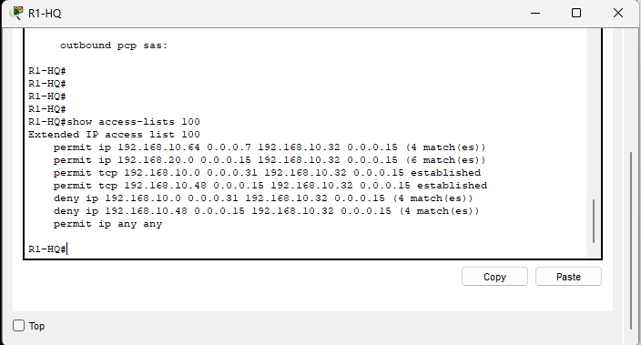

**[FILL: which approach is this — exception-based (permit most, deny specific) or least privilege (deny most, permit specific)? Say which, then explain what it permits and what it blocks. And say why you applied it outbound on the HR subinterface rather than inbound somewhere else — direction and placement are a real decision and most people can't explain theirs.]**

### ACL 110 — R2-REMOTE, on Gi0/0

```
[PASTE: ACL 110 statements as text.]
```

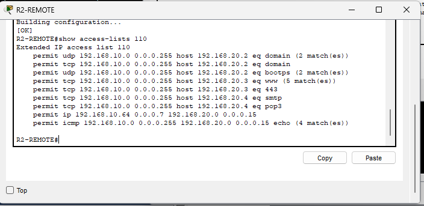

**[FILL: this one uses the opposite philosophy to ACL 100. Explain the contrast. Which do you think is more defensible, and what does each cost to operate? An exception-based list is easy to maintain and fails open when someone forgets an entry; a least-privilege list fails closed and generates support tickets. That trade-off is the answer.]**

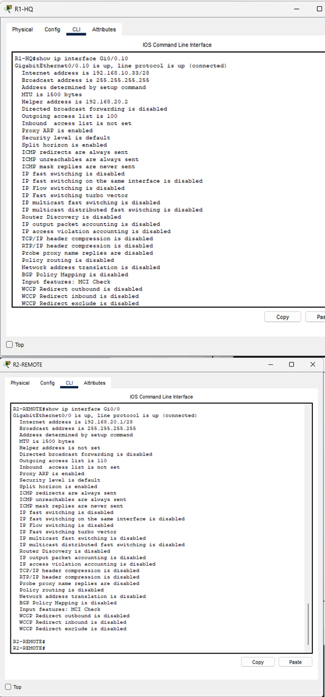
*Outgoing ACL 100 on Gi0/0.10, ACL 110 on Gi0/0 — confirming the lists are where I think they are, which is worth checking rather than assuming.*

**What neither of them does.** Both are stateless. They match addresses, protocols and ports. The `established` keyword looks at TCP flags, not at whether a session actually exists — so a crafted packet with the ACK bit set walks straight through a rule that looks like it's permitting return traffic only.

---

## Port security

17 access ports, with violation modes tiered by how much I trusted the physical location of each.

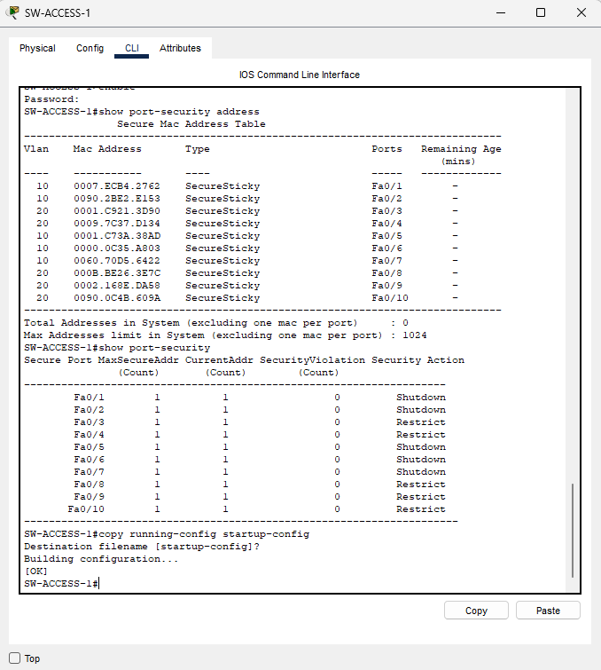

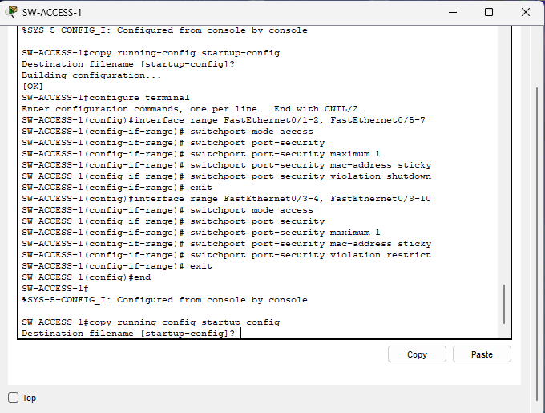

**[FILL: which ports got which violation mode, and your reasoning. What made one department's ports higher risk than another's? How many MAC addresses per port, and sticky or static learning? Sticky is convenient and survives a reboot if you save; static means you type every address but nothing gets learned by accident. Say which you picked and what it costs operationally.]**

**What it doesn't do.** Port security binds a port to a MAC address it has learned. It doesn't authenticate anything. Someone who spoofs a permitted MAC passes it without difficulty. It raises the effort required rather than closing the door, and the control that would actually close it is 802.1X.

---

## Layer 2 hardening

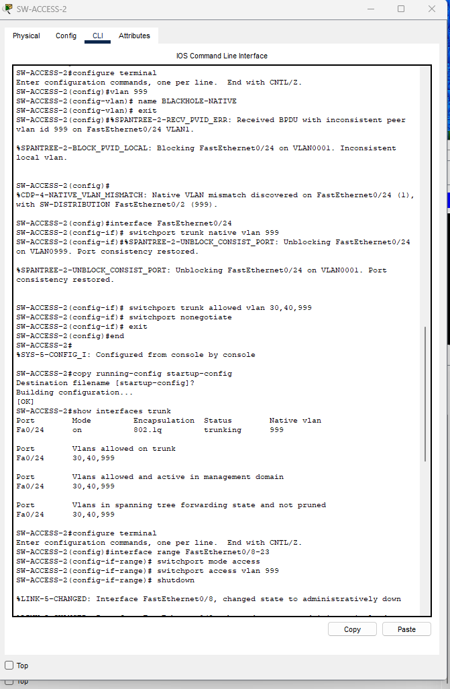

Four things, all cheap, all worth doing:

- Native VLAN set to 999 on every trunk, with no routed interface — closes double tagging
- Per-trunk VLAN pruning, so each link only carries what it needs
- Trunk negotiation disabled, so a host can't negotiate its way onto a trunk
- Every unused port in VLAN 999 and administratively shut down

None of these is clever. All of them are the kind of thing that gets skipped because the network works fine without them.

---

## Device hardening

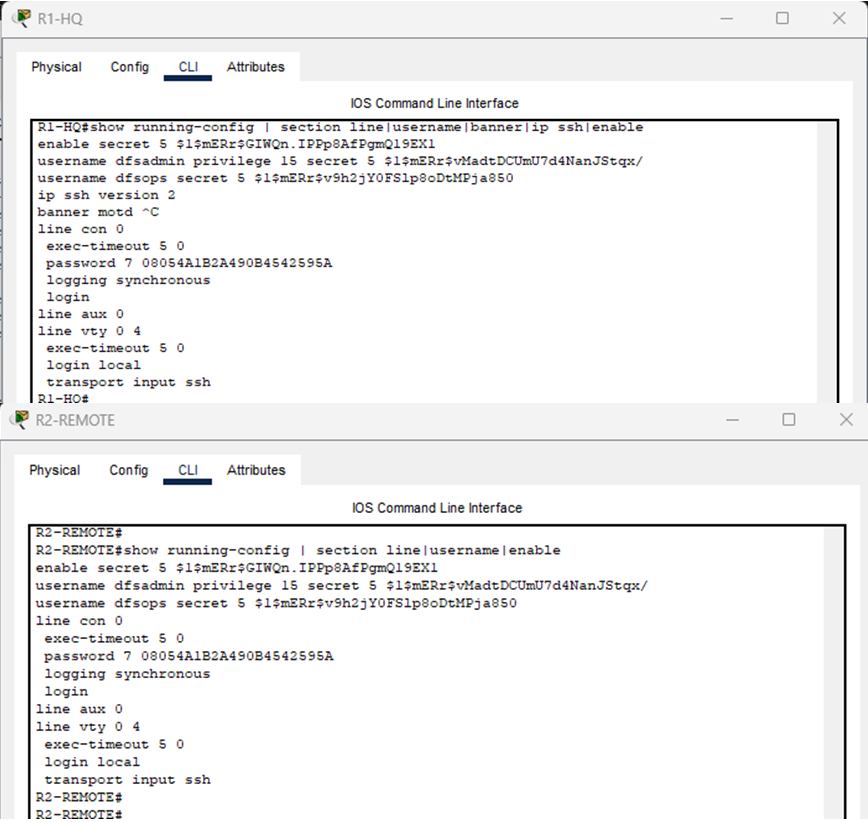

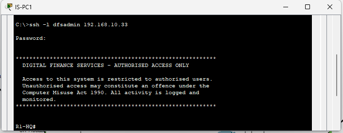

What I set: enable secret, local accounts with separated privilege levels, SSH version 2 only with `transport input ssh` so Telnet can't be used as a fallback, a lawful-access banner, service password-encryption, and VLAN 1 shut down on the switches.

**[FILL: key modulus you generated, and whether you set exec-timeout and login attempt limits. Also a line on the banner — it's there for legal reasons as much as technical ones, since unauthorised access is easier to act on when the system told the person they weren't authorised.]**

---

## IPsec site-to-site VPN

The tunnel protects Human Resources traffic to the external server site. Crypto map `DFS-VPN-MAP` at both WAN endpoints, with traffic selectors mirrored on each side.

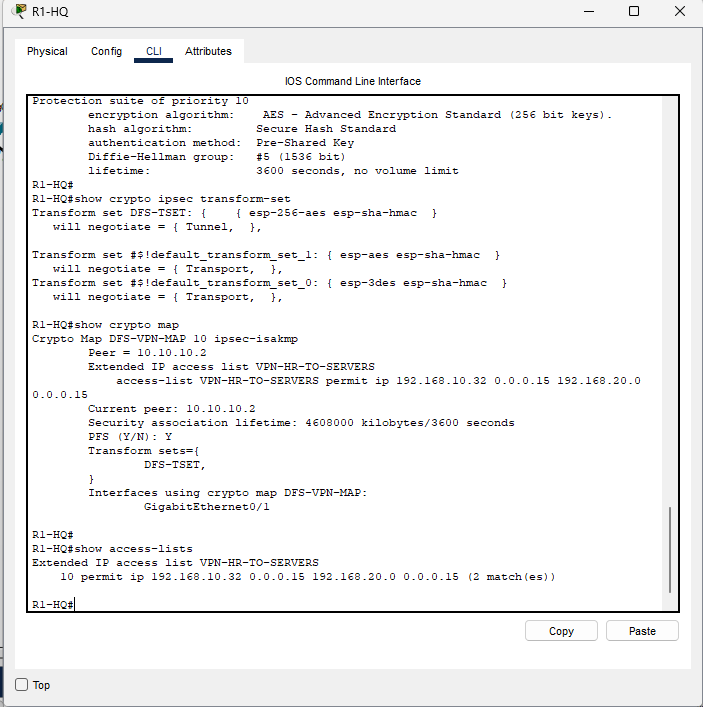

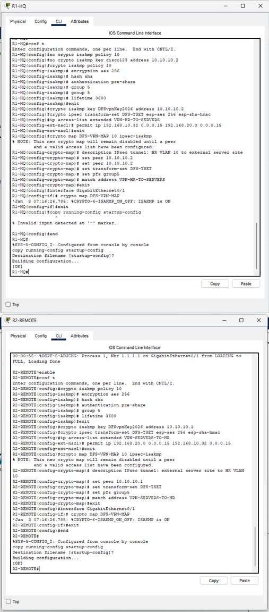

```
[PASTE: show crypto isakmp policy output as text — the Phase 1 parameters are the
thing anyone reading this will want to see written out.]
```

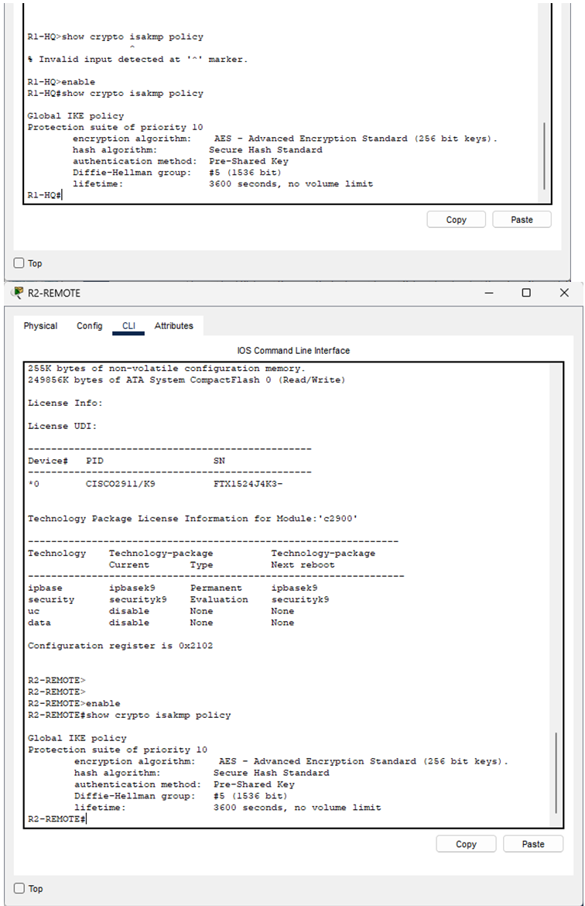

**[FILL: Phase 1 parameters — encryption, hash, DH group, lifetime. Phase 2 transform set. What the crypto ACL actually matches.]**

### What the tunnel really gives me

**[FILL: this is the strongest analysis in the project and it deserves proper space. ESP gives confidentiality and integrity for traffic inside the selector. It gives nothing to traffic outside it. It gives nothing for availability — in fact it adds a dependency, because if negotiation fails the protected traffic doesn't fall back to plaintext, it stops. Be precise about which of the three properties you actually get and for which traffic.]**

### Proving the scope boundary

I didn't want to just assert that the tunnel was scope-limited, so I showed it.

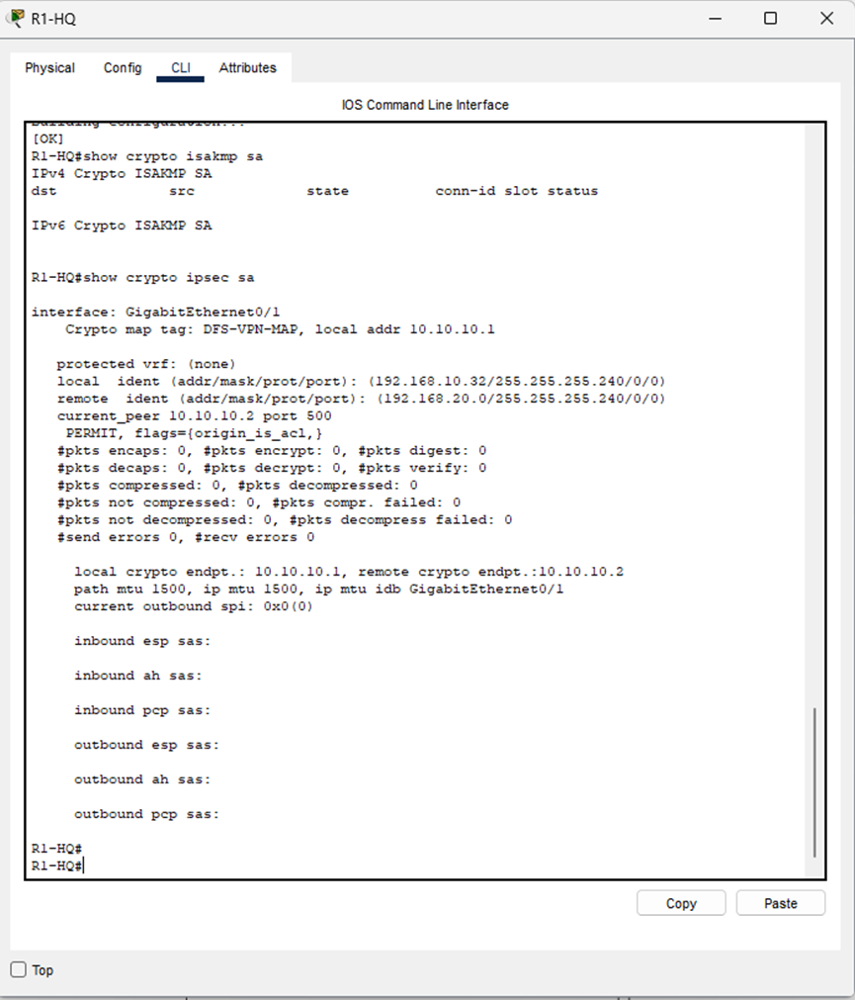
*Empty ISAKMP table, no security associations, counters at zero.*

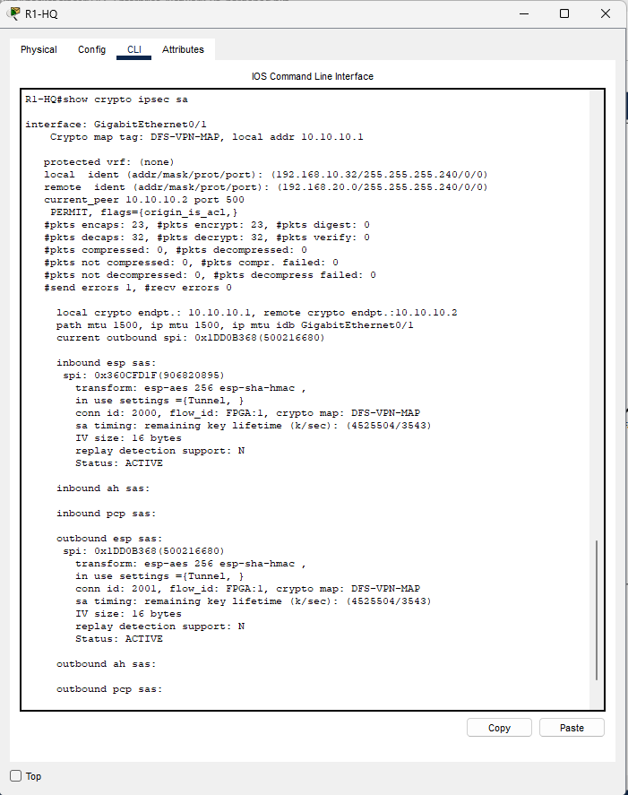
*After HR traffic to the server site — encapsulation and decapsulation counters incrementing.*

Then the test that actually matters: I sent Marketing traffic to the same destination and watched the counters not move.

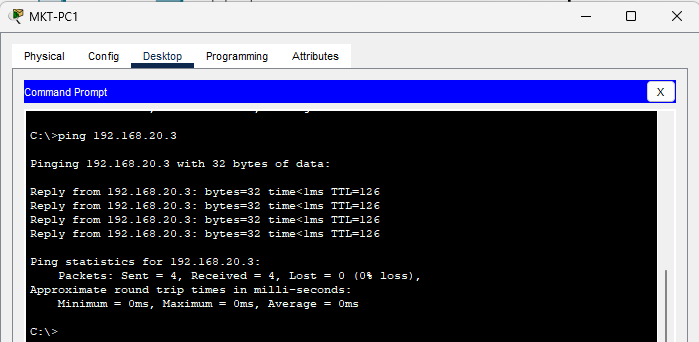
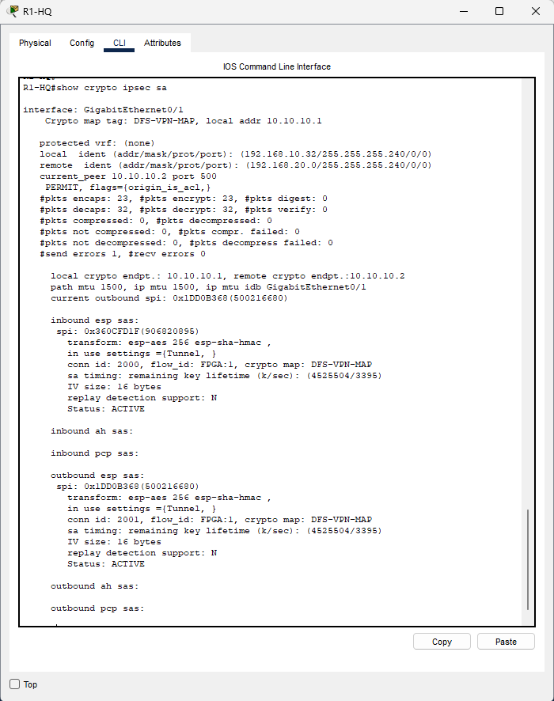
*Same destination, same WAN link, traffic delivered successfully — and the tunnel counters completely static. That traffic crossed the link in the clear.*

Those two images together are the most useful thing I produced on this project. They're the evidence for the main finding in [residual-risk.md](residual-risk.md): the tunnel works exactly as specified, and what it was specified to do leaves customer data unprotected on the same path.

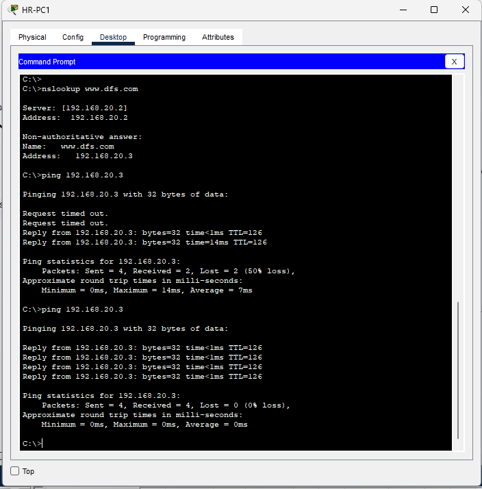
*The first HR packet to the server site triggers negotiation, so it's slow or lost. Worth knowing before someone reports it as a fault.*
