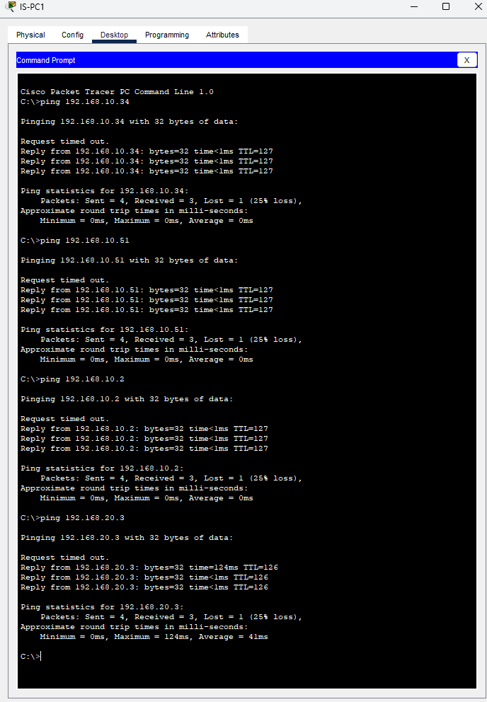
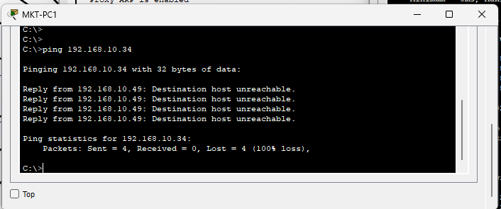
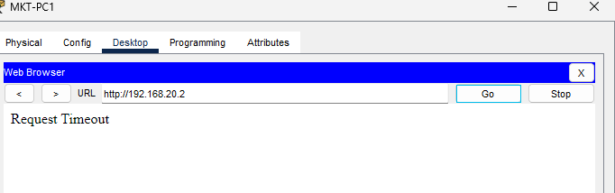
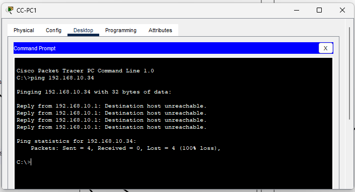

# Testing

I tested connectivity, routing, segmentation, access control and the VPN against a structured matrix.

| # | Category | What I tested | How | Expected | What happened | Result |
|---|---|---|---|---|---|---|
| 1 | Connectivity | IS access to other networks | `ping 192.168.10.34`, `ping 192.168.10.51`, `ping 192.168.10.2`, `ping 192.168.20.3` from IS-PC1 | Traffic permitted | Hosts replied successfully after the initial packet | PASS |
| 2 | ACL 100 | Marketing initiating traffic to HR | `ping 192.168.10.34` from MKT-PC1 | Blocked | `Destination host unreachable` returned by `192.168.10.49` | PASS |
| 3 | ACL 100 | Customer Centric initiating traffic to HR | `ping 192.168.10.34` from CC-PC1 | Blocked | `Destination host unreachable` returned by `192.168.10.1` | PASS |
| 4 | ACL 110 | Unauthorised HTTP service | Open `http://192.168.20.2` from MKT-PC1 | Blocked | Browser returned `Request Timeout` | PASS |
| 5 | IPsec | HR traffic to server site | Send HR traffic to the server subnet, then run `show crypto ipsec sa` | VPN SA established and counters increase | SA established and IPsec counters increased | PASS |
| 6 | IPsec scope | Marketing traffic to same server site | Send Marketing traffic, then compare `show crypto ipsec sa` counters | Traffic permitted but not encrypted | Traffic succeeded while VPN counters stayed unchanged | PASS |

---

## Baseline Test

Before testing the restrictions, I confirmed that Information Systems could reach the other networks.

Example tests from IS-PC1 included:

```text
ping 192.168.10.34
ping 192.168.10.51
ping 192.168.10.2
ping 192.168.20.3
```

The destinations responded successfully.

The first packet sometimes timed out, but the following packets succeeded. This is normal during initial address resolution and, for protected remote traffic, can also occur while the VPN security associations are being established.

This baseline was important because it showed that routing worked before I treated later failures as evidence of ACL enforcement.

---

## The negative tests

These were the most useful tests because a successful ping only proves that connectivity exists. A failed test, when the failure is expected, proves that a security policy is being enforced.


### Marketing to HR

```text
C:\>ping 192.168.10.34

Reply from 192.168.10.49: Destination host unreachable.
Reply from 192.168.10.49: Destination host unreachable.
Reply from 192.168.10.49: Destination host unreachable.
Reply from 192.168.10.49: Destination host unreachable.
```

The reply comes from `192.168.10.49`, the Marketing gateway, rather than from the HR host.

This shows that the router examined the packet and rejected it before it reached HR. That is the expected behaviour of ACL 100.

### Service-Level Blocking

I also tried to open:

```text
http://192.168.20.2
```

from MKT-PC1.

The browser returned:

```text
Request Timeout
```

This test matters because the host is reachable, but HTTP to that host is not permitted by ACL 110.

ACL 110 allows the required DNS and DHCP services on `192.168.20.2`, but it does not contain a rule permitting HTTP to that address. The request therefore reaches the ACL and is blocked by the implicit deny.

This proves that the policy is filtering **services**, not simply allowing or denying an entire server.

### Customer Centric to HR

```text
C:\>ping 192.168.10.34

Reply from 192.168.10.1: Destination host unreachable.
Reply from 192.168.10.1: Destination host unreachable.
Reply from 192.168.10.1: Destination host unreachable.
Reply from 192.168.10.1: Destination host unreachable.
```

The same HR restriction was tested from Customer Centric.

This time the rejection comes from `192.168.10.1`, the Customer Centric gateway.

Again, this shows that the packet reached the gateway and was deliberately rejected rather than simply disappearing somewhere in the network.

A **gateway-generated unreachable message** and a **timeout** therefore mean different things:

- `Destination host unreachable` from the gateway shows that a device actively rejected the traffic.
- `Request Timeout` shows that no successful response returned to the application.

---

## What Went Wrong First Time

The main issue during testing was that the **first packet sometimes timed out**, even when the connection was supposed to work.

Repeating the test produced successful replies.

This was not an ACL failure. The network needed time for initial processes such as ARP resolution and, for protected WAN traffic, IPsec tunnel establishment.

This is why I did not treat a single failed first packet as proof that the configuration was wrong. I repeated the test and checked the relevant routing, ACL or VPN state before deciding whether it had actually failed.

---

## What These Tests Don't Prove

Packet Tracer simulates the network rather than implementing every feature exactly as real hardware would.

The tests prove that the **configured policies behave as intended inside the simulation**, but they do not prove:

- Real cryptographic strength or performance
- Real network throughput under load
- Behaviour during router, switch or WAN failure
- Protection against a compromised endpoint
- Resistance to MAC spoofing
- Long-term key rotation behaviour
- Real logging and SIEM integration
- Performance with many simultaneous users

The tests therefore demonstrate that the design works logically, but further testing would be required before treating it as a production-ready network.
